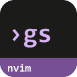
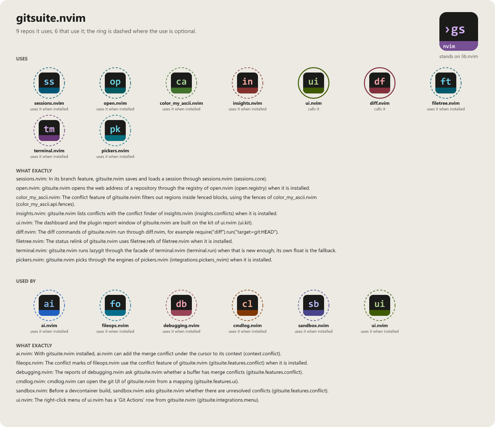

> **Alpha stage — active development.** Every `:Git` subcommand is a real
> implementation (see [docs/BINDINGS.md](docs/BINDINGS.md) for the full
> list), but the surface is not frozen: breaking changes are still
> possible. Pin a commit if you depend on it.

# gitsuite.nvim

```
 ██████╗ ██╗████████╗███████╗██╗   ██╗██╗████████╗███████╗
██╔════╝ ██║╚══██╔══╝██╔════╝██║   ██║██║╚══██╔══╝██╔════╝
██║  ███╗██║   ██║   ███████╗██║   ██║██║   ██║   █████╗
██║   ██║██║   ██║   ╚════██║██║   ██║██║   ██║   ██╔══╝
╚██████╔╝██║   ██║   ███████║╚██████╔╝██║   ██║   ███████╗
 ╚═════╝ ╚═╝   ╚═╝   ╚══════╝ ╚═════╝ ╚═╝   ╚═╝   ╚══════╝
                                               .nvim
```

> Sister plugin: [diff.nvim](https://github.com/WKDSteve/diff.nvim) (a
> hard dependency here for `:Git diff *`).

[](LICENSE)
[](https://neovim.io)
[](https://www.lua.org)

[](https://github.com/WKDSteve/gitsuite.nvim/actions/workflows/ci.yml)
[](https://wkdsteve.github.io/wkd/p/gitsuite/)

> Part of the [wkd](https://wkdsteve.github.io/wkd/) family — see this plugin's [page](https://wkdsteve.github.io/wkd/p/gitsuite/) on the site.

One `:Git <scope> <action>` command tree for everything git in Neovim — own
implementation where that pays off (merge-conflict resolution, blame,
browse), thin adapters where it does not (gitsigns' hunk engine, neogit's
staging UI, diffview, the real `lazygit` TUI in a float). Plus `:Git
dashboard`, a multi-repo git-status panel across a whole folder of clones,
with push/pull/fetch per row, per marked set, or for the whole folder —
moved here from
[reposcope.nvim](https://github.com/WKDSteve/reposcope.nvim), which
stays scoped to GitHub/GitLab/Codeberg discovery. And `:Git plugins`: after a
`:Lazy sync`, `:Git plugins report` says which plugins the update changed and
which commits that brought, in a report tab of its own (overview, breaking
digest, detail per plugin, preview; `:Git plugins` opens it again) (or, with `--mode=pending`, what the next update
would bring) — with a summary per plugin, the releases of the range and the
commits that are marked breaking, each with its place in the update ("17/86")
and whether it concerns your setup (a heuristic, and the report says so) — and
`:Git plugins log` shows the newest commits of one plugin
or any clone in a picker with a preview — both read local state only: no
fetch (unless you ask for one with `report --mode=pending --fetch`), no
install, no change to any clone.

---

## Documentation

Start at [docs/README.md](docs/README.md) — what's where, and which
question each page answers.

**The Basics**

- [Requirements](docs/requirements.md) — hard dependencies, optional tools, and what each one backs.
- [Installation](docs/installation.md) — a spec per plugin manager.
- [Quickstart](docs/quickstart.md) — the first thing to run after installing.

**Configuration**

- [What you get with the defaults](docs/what-you-get.md) — the handful of things that matter on day one.
- [All options](docs/configuration.md) — every `setup()` option and its default.
- [Commands](docs/commands.md) / [Bindings cheatsheet](docs/BINDINGS.md)

**The Rest**

- [Around it](docs/around-it.md) — how this plugin's scope differs from the plugins it sits next to or replaces.
- [What it does and what not](docs/scope.md)
- [Why it does it that way](docs/architecture.md)
- [Health check](docs/health.md) — what `:checkhealth gitsuite` reports, line by line.
- [Cross-platform notes](docs/cross-platform.md)
- [Contributing](docs/CONTRIBUTING.md)
- [Feedback](https://github.com/WKDSteve/gitsuite.nvim/issues)

`:help gitsuite` is the same reference inside the editor.

---

## License

gitsuite.nvim is released under the [MIT License](https://opensource.org/licenses/MIT) — see [LICENSE](LICENSE).

<!-- connections:begin (written by the app-icons tool of the workshop; change integrations.json there, not this block) -->
## Connections



**Uses**

- [color_my_ascii.nvim](https://github.com/WKDSteve/color_my_ascii.nvim): The conflict feature of gitsuite.nvim filters out regions inside fenced blocks, using the fences of color_my_ascii.nvim (`color_my_ascii.api.fences`). ([picture](assets/graphs/pair/gitsuite.nvim--color_my_ascii.nvim.png))
- [diff.nvim](https://github.com/WKDSteve/diff.nvim): The diff commands of gitsuite.nvim run through diff.nvim, for example `require("diff").run("target=git:HEAD")`. ([picture](assets/graphs/pair/gitsuite.nvim--diff.nvim.png))
- [filetree.nvim](https://github.com/WKDSteve/filetree.nvim): The status relink of gitsuite.nvim uses `filetree.refs` of filetree.nvim when it is installed. ([picture](assets/graphs/pair/gitsuite.nvim--filetree.nvim.png))
- [insights.nvim](https://github.com/WKDSteve/insights.nvim): gitsuite.nvim lists conflicts with the conflict finder of insights.nvim (`insights.conflicts`) when it is installed. ([picture](assets/graphs/pair/gitsuite.nvim--insights.nvim.png))
- [open.nvim](https://github.com/WKDSteve/open.nvim): gitsuite.nvim opens the web address of a repository through the registry of open.nvim (`open.registry`) when it is installed. ([picture](assets/graphs/pair/gitsuite.nvim--open.nvim.png))
- [pickers.nvim](https://github.com/WKDSteve/pickers.nvim): gitsuite.nvim picks through the engines of pickers.nvim (`integrations.pickers_nvim`) when it is installed. ([picture](assets/graphs/pair/gitsuite.nvim--pickers.nvim.png))
- [sessions.nvim](https://github.com/WKDSteve/sessions.nvim): In its branch feature, gitsuite.nvim saves and loads a session through sessions.nvim (`sessions.core`). ([picture](assets/graphs/pair/gitsuite.nvim--sessions.nvim.png))
- [terminal.nvim](https://github.com/WKDSteve/terminal.nvim): gitsuite.nvim runs lazygit through the facade of terminal.nvim (`terminal.run`) when that is new enough; its own float is the fallback. ([picture](assets/graphs/pair/gitsuite.nvim--terminal.nvim.png))
- [ui.nvim](https://github.com/WKDSteve/ui.nvim): The dashboard and the plugin report window of gitsuite.nvim are built on the kit of ui.nvim (`ui.kit`). ([picture](assets/graphs/pair/gitsuite.nvim--ui.nvim.png))
- [lib.nvim](https://github.com/WKDSteve/lib.nvim): the shared base of the plugins.

**Used by**

- [ai.nvim](https://github.com/WKDSteve/ai.nvim): With gitsuite.nvim installed, ai.nvim can add the merge conflict under the cursor to its context (`context.conflict`). ([picture](assets/graphs/pair/ai.nvim--gitsuite.nvim.png))
- [cmdlog.nvim](https://github.com/WKDSteve/cmdlog.nvim): cmdlog.nvim can open the git UI of gitsuite.nvim from a mapping (`gitsuite.features.ui`). ([picture](assets/graphs/pair/cmdlog.nvim--gitsuite.nvim.png))
- [debugging.nvim](https://github.com/WKDSteve/debugging.nvim): The reports of debugging.nvim ask gitsuite.nvim whether a buffer has merge conflicts (`gitsuite.features.conflict`). ([picture](assets/graphs/pair/debugging.nvim--gitsuite.nvim.png))
- [fileops.nvim](https://github.com/WKDSteve/fileops.nvim): The conflict marks of fileops.nvim use the conflict feature of gitsuite.nvim (`gitsuite.features.conflict`) when it is installed. ([picture](assets/graphs/pair/fileops.nvim--gitsuite.nvim.png))
- [sandbox.nvim](https://github.com/WKDSteve/sandbox.nvim): Before a devcontainer build, sandbox.nvim asks gitsuite.nvim whether there are unresolved conflicts (`gitsuite.features.conflict`). ([picture](assets/graphs/pair/sandbox.nvim--gitsuite.nvim.png))
- [ui.nvim](https://github.com/WKDSteve/ui.nvim): The right-click menu of ui.nvim has a 'Git Actions' row from gitsuite.nvim (`gitsuite.integrations.menu`). ([picture](assets/graphs/pair/ui.nvim--gitsuite.nvim.png))
<!-- connections:end -->
